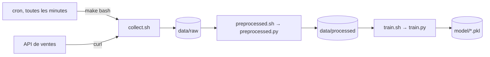

# Pipeline MLOps en Bash : collecte, prétraitement et réentraînement automatisés

Ce dépôt automatise de bout en bout un pipeline de machine learning sur une machine Linux. Toutes les minutes, les ventes de cinq modèles de cartes graphiques sont collectées depuis une API, nettoyées et transformées. Un modèle XGBoost est ensuite réentraîné et versionné. L'ensemble repose uniquement sur des outils standards de Linux (Bash, cron, Make), sans orchestrateur.

Il s'agit de l'examen du module Linux & Bash de ma formation Machine Learning Engineer (Liora x Mines), réalisé sur une VM Ubuntu distante. L'école fournissait l'arborescence, les tests et un jeu de données initial. Les scripts Bash, le code Python, le Makefile, la planification cron et la gestion des dépendances sont ce que j'ai réalisé.



## Ce que j'ai écrit

| Fichier | Rôle |
|---|---|
| `scripts/collect.sh` | Interroge l'API pour chaque modèle de carte et ajoute les ventes à un nouveau CSV horodaté |
| `src/preprocessed.py` et `scripts/preprocessed.sh` | Nettoie les données brutes et produit un jeu de variables entièrement numériques |
| `src/train.py` et `scripts/train.sh` | Entraîne un XGBoost, calcule RMSE, MAE et R², sauvegarde le modèle |
| `Makefile` | Point d'entrée unique : `make bash` lance le pipeline, `make tests` le vérifie |
| `scripts/cron.txt` | Planifie le pipeline complet toutes les minutes |
| `pyproject.toml`, `uv.lock`, `requirements.txt` | Environnement reproductible géré avec uv |

Chaque étape écrit un journal horodaté dans `logs/`. Les journaux d'une exécution réelle sont versionnés dans ce dépôt.

## Choix techniques

**Une seule ligne cron qui appelle `make bash`.** Trois lignes cron indépendantes, une par script, démarreraient au même instant : le prétraitement pourrait lire un fichier en cours d'écriture, ou l'entraînement tourner sur des données pas encore prétraitées. Passer par le Makefile garantit l'ordre des étapes, et le pipeline n'est défini qu'à un seul endroit, utilisé aussi bien à la main que par cron.

**Des scripts indépendants de l'endroit d'où on les lance.** Cron s'exécute avec un `PATH` minimal, sans environnement virtuel activé, depuis le répertoire personnel. Chaque script calcule donc la racine du projet à partir de son propre emplacement et appelle l'interpréteur Python du venv par chemin absolu. Les mêmes scripts fonctionnent depuis un terminal, depuis make et depuis cron.

**Des échecs visibles et propagés.** Les scripts Bash commencent par `set -euo pipefail`. En cas d'erreur, Python journalise la trace complète et sort avec un code non nul, que le script Bash journalise et propage à son tour. Make arrête alors la chaîne : un modèle n'est jamais entraîné sur un prétraitement qui a échoué.

**Une collecte qui accumule l'historique.** Chaque collecte repart du fichier brut le plus récent au lieu du fichier initial, si bien que le jeu de données grossit à chaque passage. Seules les réponses de l'API qui sont des entiers positifs sont écrites, et une erreur sur un modèle n'empêche pas la collecte des autres.

**Un découpage temporel pour l'évaluation.** Les lignes arrivent dans l'ordre chronologique. Le découpage train/test se fait sans mélange, pour que le jeu de test contienne les ventes les plus récentes, comme lorsqu'on prédit le futur. Le modèle de carte est encodé en one-hot plutôt qu'en entier, pour ne pas introduire un ordre artificiel entre les modèles.

**La traçabilité des modèles.** Les hyperparamètres et la graine aléatoire sont fixés et écrits dans le journal à chaque entraînement. Le premier modèle est sauvegardé en `model.pkl`, les suivants en `model_YYYYMMDD_HHMM.pkl`, sans écraser les précédents.

## Problèmes rencontrés


Les fichiers du dépôt fourni avaient des fins de ligne Windows (CRLF) : Bash lisait `pipefail\r` et refusait l'option. J'ai converti les scripts et le Makefile au format Unix.

Le fichier de données initial ne se terminait pas par un saut de ligne, ce qui collait la première vente collectée à la dernière ligne existante. Le script de collecte vérifie désormais le dernier caractère avant d'ajouter des lignes.

Le test de prétraitement exige que toutes les colonnes soient des entiers, mais `pd.get_dummies` produit des booléens par défaut. L'encodage force donc `dtype=int`.

L'énoncé indiquait une collecte toutes les 3 minutes à un endroit et toutes les minutes à un autre. J'ai retenu une minute pour l'ensemble du pipeline, la collecte en faisant partie.

## Aperçu d'une exécution

Extrait de `logs/collect.logs` sur la VM :

```
2026-10-28 10:50:32 - INFO - Copie de data/raw/sales_data.csv vers data/raw/sales_20261028_1050.csv
2026-10-28 10:50:32 - INFO - Début de la collecte -> data/raw/sales_20261028_1050.csv
2026-10-28 10:50:32 - INFO - Requête http://0.0.0.0:5000/rtx3060 -> modèle : rtx3060, ventes : 9
2026-10-28 10:50:32 - INFO - Requête http://0.0.0.0:5000/rtx3070 -> modèle : rtx3070, ventes : 17
2026-10-28 10:50:32 - INFO - Requête http://0.0.0.0:5000/rtx3080 -> modèle : rtx3080, ventes : 17
2026-10-28 10:50:32 - INFO - Requête http://0.0.0.0:5000/rtx3090 -> modèle : rtx3090, ventes : 16
2026-10-28 10:50:32 - INFO - Requête http://0.0.0.0:5000/rx6700 -> modèle : rx6700, ventes : 3
2026-10-28 10:50:32 - INFO - Fin de la collecte
```

## Stack

Bash, cron, GNU Make, curl, Python 3.12, uv, pandas, scikit-learn, XGBoost, pytest.

## Lancer le projet

L'API de l'examen est un binaire fourni par l'école : elle n'est pas incluse dans ce dépôt.

```bash
uv sync                    # crée l'environnement depuis uv.lock
./api &                    # API de ventes sur 0.0.0.0:5000
make bash                  # collecte -> prétraitement -> entraînement
make tests                 # vérifie les sorties de chaque étape
crontab scripts/cron.txt   # planification (adapter le chemin absolu du projet)
```

## Pour aller plus loin

Cron montre vite ses limites sur un vrai pipeline : il ne gère ni les dépendances entre tâches, ni les reprises sur erreur, ni l'historique des exécutions. En production, j'utiliserais un orchestrateur comme Airflow ou Prefect, MLflow pour suivre les entraînements et enregistrer les modèles, et DVC pour versionner les données.
